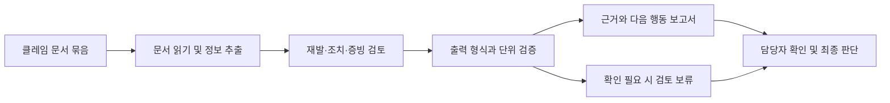

# SignalDesk AI

### 클레임 종결 전, 근거부터.

제조업 품질 클레임 문서를 분석하고, 담당자가 **근거와 다음 행동**을 확인하도록 돕는 AI 검토 지원 서비스

**Upstage Studio 해커톤 · 이공공사출생자들**

[프로젝트 종합 정리](프로젝트_종합정리.md) · [3분 발표자료](SignalDesk_AI_3분_발표자료.pdf) · [서비스 데모](이공공사출생자들_최종제출_서비스데모.mp4)

---

## 왜 만들었나요?

고객 클레임 하나를 검토하려면 접수 내용뿐 아니라 과거 8D 보고서, 시정조치, 검사 기준과 결과 등 여러 문서를 함께 살펴봐야 합니다. 필요한 정보가 흩어져 있으면 담당자는 근거를 찾고 대조하는 데 시간을 쏟게 됩니다.

**SignalDesk AI는 흩어진 문서에서 검토에 필요한 정보를 모아, 판단 사유와 근거 위치, 부족한 증빙, 다음 행동을 한눈에 제공합니다.** 최종 판단과 종결은 담당자가 원문을 확인한 뒤 결정합니다.

## 무엇을 하나요?

| 기능 | 담당자가 확인하는 내용 |
| --- | --- |
| 문서 읽기 | 클레임과 과거 조치·검사 문서에서 필요한 정보 추출 |
| 이력 및 조치 검토 | 과거 사건과의 재발 관계, 이번 조치의 효과 |
| 증빙 확인 | 부족하거나 충돌하는 자료, 추가 확인이 필요한 항목 |
| 근거 제시 | 검토에 참고할 파일과 페이지, 판단 사유 |
| 다음 행동 안내 | 자료 요청과 후속 업무를 위한 한국어 보고서 |

## 작동 흐름

제출 설정 **#98** 기준으로 P01에서 문서를 읽고 E99에서 검토 정보를 추출합니다. V01과 I10을 거쳐 결과를 정리·검증하고, I40/I41에서 한국어 보고서를 생성합니다. 검증 실패 시 보류 경로로 안내합니다. 자세한 노드 설명은 [프로젝트 종합 정리](프로젝트_종합정리.md)를 참고하세요.

## 데이터와 검증

- **입력 데이터:** FT01~FT20, 총 20개 사건별 PDF. 클레임, 과거 보고서, 검사 자료와 일부 가상 대화 자료를 포함합니다.
- **데이터 출처:** 클레임 앞면에 미국 연방조달청의 공개 [SF368 서식](https://www.gsa.gov/reference/forms/product-quality-deficiency-report)을 활용했습니다. 부속 문서와 사건 내용은 팀이 만든 합성 자료입니다.
- **저장 실행 결과:** 20건 모두 최종 7개 항목이 팀 작성 정답과 일치했습니다. 특정 실행에서 확인한 결과이며 추출 캐시 재사용이 확인됐습니다.
- **해석 범위:** 캐시 없는 반복 실행, 독립적인 현업 검수와 실제 고객 문서에 대한 성능은 아직 검증되지 않았습니다. 검증 화면의 Green은 설정된 형식·규칙 통과를 뜻하며, 내용의 정답을 보장하지 않습니다.

## 기대 효과와 확장 가능성

문서에 흩어진 근거와 후속 조치를 한곳에서 확인해 담당자의 검토를 지원합니다. 예를 들어 **건당 10분 단축, 하루 10건**을 가정하면 하루 100분의 업무시간을 확보할 수 있습니다. 시간당 3만 원, 월 20일 기준 월 100만 원 상당이며, 이는 **실측 성과나 현금 절감액이 아닌 가정에 따른 계산**입니다.

문서 읽기와 기준 대조, 누락 확인의 흐름은 구매·정산, 계약 검토 등으로 확장할 수 있습니다. 새로운 분야에서는 항목과 규칙을 다시 설계하고 실제 문서로 검증해야 합니다.

## 실행하기

1. Upstage Studio에서 새 워크플로우를 만들고 [제출용 워크플로우](이공공사출생자들_최종제출_workflow.json)를 가져옵니다.
2. FT01~FT20 PDF를 업로드하고 실행합니다.
3. 일반 경로는 I30, 단위 검토 경로는 I31의 최종 결과를 확인합니다. I40/I41은 사람이 읽는 보고서입니다.
4. 결과의 판단 사유와 근거 페이지를 원문과 대조합니다.

최종 결과의 7개 항목은 `claim_id`, `recurrence`, `verification`, `reason_codes`, `missing_evidence`, `evidence_refs`, `next_action`입니다.

> [원본 Studio 작업 공간 · 설정 #98](https://studio.upstage.ai/agents/agt_Rj4Zto6UmbqbjXQEsL?configVer=98)은 로그인 및 접근 권한이 필요합니다. 라이브러리 공개 링크는 별도 확인이 필요합니다.

## 프로젝트 자료

| 자료 | 내용 |
| --- | --- |
| [프로젝트 종합 정리](프로젝트_종합정리.md) | 노드, 검증 범위, 사례와 확장 방향 |
| [3분 발표자료](SignalDesk_AI_3분_발표자료.pdf) · [Figma Slides](https://www.figma.com/slides/tB3pUZYcDuC2OLDnUI8gOB) | 발표자료 PDF 및 편집 가능한 슬라이드 |
| [최종 제출 발표자료](이공공사출생자들_최종제출_발표자료.pdf) | 기존 제출용 발표자료 |
| [서비스 데모](이공공사출생자들_최종제출_서비스데모.mp4) | 서비스 실행 영상 |
| [설계서](이공공사출생자들_최종제출_설계서.pdf) · [유형표](이공공사출생자들_최종제출_유형표.xlsx) | 워크플로우 설계 및 입력 유형 |
| [정답 데이터](이공공사출생자들_최종제출_answer.json) | 팀 작성 비교 기준 |

---

<strong>SignalDesk AI</strong> · 더 빠른 검토를 위한, 확인할 수 있는 근거

